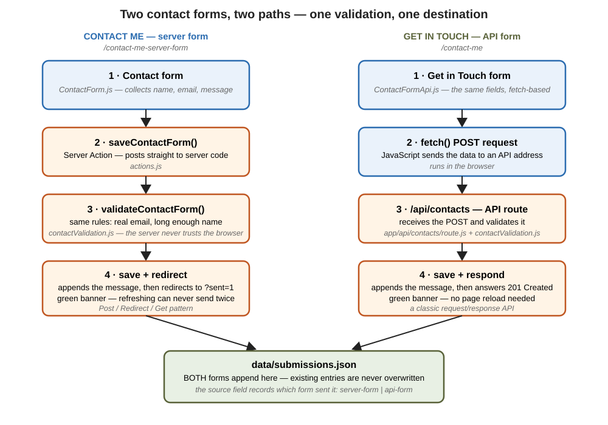
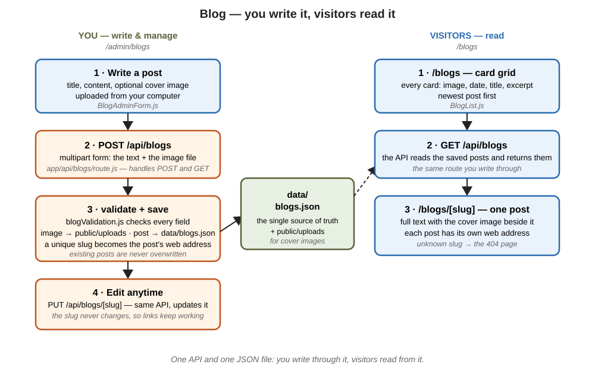

# Portfolio-Website-Part-2

## Overview

This is a continuation of the first project of my personal portfolio website. This is an improved version. Here are the new features or pages:

- **Get in Touch** (`/contact-me`) — a second contact form, built on an **API route** instead of a Server Action
- **Blog** (`/blogs`) — a public blog with a card grid and one page per post
- **Admin Blog** (`/admin/blogs`) — a private page where I publish, edit, and manage blog posts, including cover image uploads

The first part of the project lives in a separate repository: [Portfolio-Website-Part-1-](https://github.com/sevgicosan/Portfolio-Website-Part-1-). Everything built there (the pages, the dynamic project routes, and the server-side contact form) is carried over unchanged — this repository adds the new features on top of it.

Like the first part, the website was developed using the Viber Coding Agent as part of an AI-assisted software development course. Throughout the development process, I used the agent to generate code, review its implementation, test functionality, and make improvements.

## Installation and Running

Step 1 — Clone the repository and open the project folder:

```bash
git clone https://github.com/sevgicosan/Portfolio-Website-Part-2.git
cd Portfolio-Website-Part-2
```

Step 2 — Install the dependencies (Node.js 18.18+ required):

```bash
npm install
```

Step 3 — Start the development server:

```bash
npm run dev
```

Step 4 — Open the site in your browser at:

```
http://localhost:3000
```

To check code quality and produce a production build:

```bash
npm run lint
npm run build
```

## Technologies Used

- **Next.js 16** (App Router) — page routing, server actions, route handlers, static/dynamic rendering
- **React 19** — component-based UI
- **JavaScript (ES Modules)** — no TypeScript
- **CSS Modules + global stylesheet** — component-scoped styles and design tokens (no UI frameworks)
- **Server Actions** — server-side form handling without a separate API
- **Route Handlers (API routes)** — REST-style endpoints (`/api/contacts`, `/api/blogs`) with POST and PUT support
- **FormData & multipart uploads** — blog cover images sent from the browser and stored on the server
- **Cache Components (`"use cache"`)** — cached blog pages that still pick up edits (with `cacheLife`)
- **Node.js `fs` API** — contact submissions and blog posts stored in local JSON files; images in `public/uploads`
- **Inline SVG** — all icons and decorative graphics (no icon libraries)
- **Google Fonts via `next/font`** — Carlito for body text (Georgia is a system font)

## Website Pages & Features

The pages from the first part are unchanged — see [Part 1](https://github.com/sevgicosan/Portfolio-Website-Part-1-) for their details: Homepage, About Me, Work Experience, Projects with dynamic routes, the server-side **Contact Me** form, and the custom 404 page.

The navigation bar now includes two new links: **Blog** and **Get in Touch**.

**`/contact-me` — Get in Touch (API contact form)**
A second, independent contact form backed by an **API route** instead of a Server Action:
- The form (`ContactFormApi.js`) collects the same fields and sends them with a **POST** request to `/api/contacts`
- The route validates the input **on the server** using the same shared rules (`contactValidation.js`) — the browser is never trusted
- Valid submissions are **appended** to the same `data/submissions.json`, and each entry records which form sent it (`source: "server-form"` or `"api-form"`)
- The route answers with **201 Created**, and the page shows a green confirmation banner without a page reload

### Contact Forms: Server Form vs API Form

Both forms use the same validation rules and save to the same JSON file — the difference is the path the message travels:

<p align="center">
  
</p>

**`/admin/blogs` — Admin Blog (writing and managing)**
A private page (not in the navigation, not indexed by search engines) where I manage the blog:
- **Publish** a post with a title, content, and an optional cover image uploaded from my computer (image type and size are validated on the server, the file is stored in `public/uploads`)
- Each post is **appended** to `data/blogs.json` with a unique **slug** that becomes its web address — existing posts are never overwritten
- A list of all published posts with **Edit** and **Delete** buttons: editing loads the post back into the form and saves through `PUT /api/blogs/[slug]` — the slug never changes, so existing links keep working, and a replaced image is cleaned up automatically. Deleting (after a confirmation dialog) removes the post through `DELETE /api/blogs/[slug]` along with its uploaded image if no other post uses it

**`/blogs` — Blog (reading)**
The public card grid: every post appears as a card with its cover image (or a placeholder), date, title, and an excerpt — newest first.

**`/blogs/[slug]` — Blog post page**
One page per post, rendered from a single dynamic component: the full text with the cover image sitting beside it, and a link back to all posts. Unknown slugs (e.g. `/blogs/does-not-exist`) fall through to the **404 page**.

### Blog: Writing and Reading Flow

One API and one JSON file connect both sides — I write through it, visitors read from it:

<p align="center">
  
</p>
